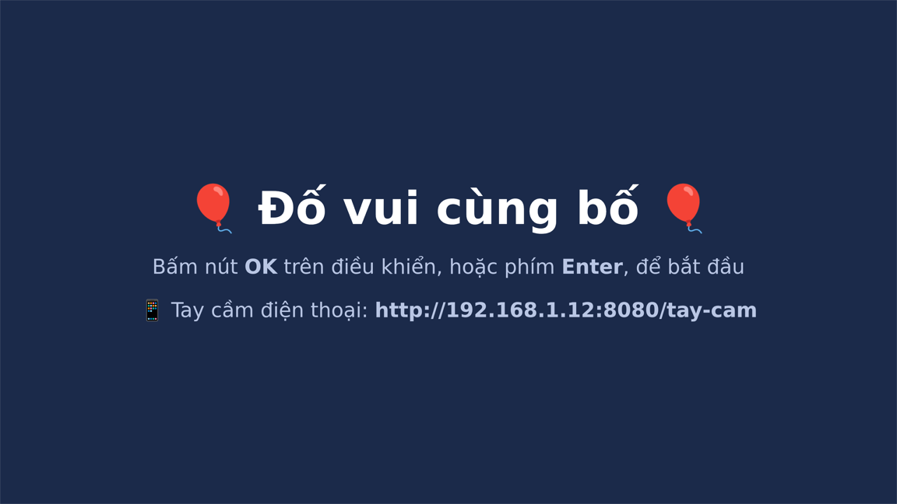

# Pi Học Vui 🎈

Biến Raspberry Pi thành "trợ lý học tập" cho bé lớp 2: nói tiếng Việt qua loa, chơi đố vui trên TV,
nhắc giờ sáng tối. Toàn bộ chạy **trong nhà, không cần internet** sau khi cài.



## Có gì?

| | Mô tả |
|---|---|
| 🎮 **Đố vui trên TV** ([do_vui/](do_vui)) | 66 câu: cộng trừ có nhớ, bảng nhân 2 và 5, chính tả (s/x, l/n, tr/ch, hỏi/ngã), tìm vần. Mỗi lượt 10 câu, có giọng đọc, có sao thưởng. |
| 📱 **Tay cầm điện thoại** | Mở `http://<ip-của-pi>:8080/tay-cam` trên điện thoại: 4 nút màu to, nút OK, nút Nghe lại. |
| 👶 **Bé tập nói** (cho bé khoảng 2 tuổi) | Bé chạm hình trên điện thoại (`http://<ip-của-pi>:8080/be`) hoặc đập bàn phím: TV hiện hình to và đọc *"Con mèo. Meo meo! Mèo."*. Có 32 từ trong 5 nhóm: con vật, nhà mình, ăn uống, đồ chơi, cơ thể. |
| ☀️ **Chào buổi sáng** ([chao_sang.py](chao_sang.py)) | Đọc thứ, ngày tháng và một câu đố cộng, rồi đọc đáp án sau 15 giây. |
| 🌙 **Chúc ngủ ngon** ([chuc_ngu_ngon.py](chuc_ngu_ngon.py)) | Nhắc ngày mai đi học hay nghỉ, đọc một câu ca dao (2 lần), nhắc đánh răng. |

Giọng đọc dùng [VieNeu-TTS v3 Turbo](https://huggingface.co/pnnbao-ump/VieNeu-TTS-v3-Turbo), chạy ngay trên Pi.

## Phần cứng

- Raspberry Pi 4 (đã thử trên bản 4GB), Raspberry Pi OS Bookworm 64-bit có giao diện desktop
- Loa (cắm jack 3.5mm, USB hoặc qua HDMI của TV)
- TV hoặc màn hình HDMI, cho trò Đố vui
- Bàn phím hoặc điện thoại để chơi. Điều khiển TV qua HDMI-CEC cũng được hỗ trợ, nếu dây micro-HDMI có dây CEC.

## Cài đặt

Trên Pi:

```bash
git clone https://github.com/anhnbt/pi-hoc-vui.git ~/hoc
cd ~/hoc
python3 -m venv vieneu-venv
./vieneu-venv/bin/pip install vieneu "onnxruntime==1.22.1"
```

> `onnxruntime` phải ghim ở `1.22.1`: bản 1.31 từ chối nạp model từ bộ nhớ đệm HuggingFace
> (lỗi *External data path escapes model directory*).

Đặt múi giờ Việt Nam, để giờ hẹn chạy đúng:

```bash
sudo timedatectl set-timezone Asia/Ho_Chi_Minh
```

### Trò Đố vui

```bash
cd ~/hoc/do_vui
../vieneu-venv/bin/python tao_cau_hoi.py   # tạo giọng đọc cho kho câu hỏi, Pi 4 mất khoảng 10 phút
../vieneu-venv/bin/python tao_be.py        # tạo giọng đọc cho Bé tập nói, khoảng 5 phút
bash cai_dat.sh                            # máy chủ tự chạy + trò chơi tự mở khi bật Pi
./mo_tro_choi.sh                           # mở ngay, không cần khởi động lại
```

Thêm câu hỏi: sửa danh sách trong `tao_cau_hoi.py` rồi chạy lại. Câu nào đã có giọng đọc thì được bỏ qua.

| Điều khiển | Chọn ô | Trả lời | Nghe lại |
|---|---|---|---|
| Bàn phím | phím số 1–4, hoặc mũi tên | Enter | R |
| Điện thoại | nút màu 1–4 | OK ▶ | 🔊 |
| Điều khiển TV (CEC) | nút màu, hoặc mũi tên | OK | Back |

**Hai bé dùng chung một TV:** chạm hình trên tay cầm của em thì TV chuyển sang Bé tập nói. Bấm tay cầm Đố vui thì TV quay về trò của anh. Nếu anh đang chơi dở một lượt, TV không chuyển sang trò của em.

### Xem camera trên TV

Hiện camera Imou (hoặc Dahua) trong nhà lên TV: bấm **📷 Xem camera trên TV** trên tay cầm điện thoại, bấm OK để quay về.
Cần lưu mật khẩu thiết bị của camera (mặc định là Safety Code in trên tem) vào `~/hoc/camera.env`:

```bash
printf 'CAM_MAT_KHAU=%s\n' 'MAT_KHAU' > ~/hoc/camera.env && chmod 600 ~/hoc/camera.env
```

Địa chỉ camera đặt trong `CAM_IP` ở đầu `may_chu.py`. Máy chủ dùng ffmpeg đổi luồng phụ 640×480 sang MJPEG cho trình duyệt,
và chỉ chạy ffmpeg khi đang có màn hình xem camera.

**Báo em bé khóc:** máy chủ nghe micro camera và đo độ to mỗi nửa giây. Pi chỉ đo, không ghi âm lại.
Khi có tiếng to khoảng 3 giây liền, loa Pi đọc *"Bố mẹ ơi! Em bé đang khóc đấy!"*, TV tự chuyển sang camera
(trừ khi anh đang chơi dở một lượt) và `~/hoc/log.txt` ghi lại giờ báo. Sau mỗi lần báo, máy chủ nghỉ 2 phút.
Ngưỡng mặc định là -25 dBFS (`NGUONG_KHOC` trong `may_chu.py`): báo nhầm nhiều thì tăng lên (ví dụ -20), không báo thì hạ xuống (ví dụ -30).

**Nói qua loa camera:** `python3 do_vui/loa_camera.py <file.wav>` phát một file âm thanh ra loa camera,
qua kênh âm thanh ngược của RTSP theo chuẩn ONVIF (G.711 A-law 8 kHz).

### Nhắc nghỉ giữa buổi học gia sư

Cô dạy 18:30–20:00 nhưng không cố định thứ nào. Cron chạy [do_vui/nhac_nghi.py](do_vui/nhac_nghi.py) lúc 18:30 mỗi ngày:
từ 18:30 đến 18:50, cứ 20 giây Pi đếm số người trong phòng một lần (YOLO11n, chỉ đếm, không nhận mặt, không lưu ảnh).
Quá nửa số lần đếm thấy từ 2 người trở lên thì hôm đó tính là có buổi học. Khi đó loa camera nhắc cô cho con nghỉ 5 phút lúc 19:15,
và nhắc học tiếp lúc 19:20. Mỗi ngày `log.txt` ghi lại có buổi học hay không.

```bash
mkdir -p ~/hoc/mo_hinh
curl -L -o ~/hoc/mo_hinh/yolo11n.onnx https://github.com/ultralytics/assets/releases/download/v8.3.0/yolo11n.onnx
cd ~/hoc/do_vui && ../vieneu-venv/bin/python nhac_nghi.py --thu   # thử ngay: đếm 1 phút rồi nhắc luôn
```

Thêm vào `crontab -e`:

```
30 18 * * * XDG_RUNTIME_DIR=/run/user/1000 $HOME/hoc/vieneu-venv/bin/python $HOME/hoc/do_vui/nhac_nghi.py >> $HOME/hoc/log.txt 2>&1
```

Thoát trò chơi bằng **Alt+F4**. Muốn tắt tự mở: xoá file `~/.config/autostart/do-vui.desktop`.

### Chào buổi sáng và chúc ngủ ngon

Chạy `crontab -e` và thêm hai dòng sau. Đổi `1000` thành kết quả của lệnh `id -u` nếu khác.

```
44 6 * * 1-5 XDG_RUNTIME_DIR=/run/user/1000 $HOME/hoc/vieneu-venv/bin/python $HOME/hoc/chao_sang.py >> $HOME/hoc/log.txt 2>&1
28 20 * * *  XDG_RUNTIME_DIR=/run/user/1000 $HOME/hoc/vieneu-venv/bin/python $HOME/hoc/chuc_ngu_ngon.py >> $HOME/hoc/log.txt 2>&1
```

- Cron chạy sớm hơn giờ đọc 1–2 phút, vì Pi 4 cần khoảng 1 phút để tạo giọng.
- Thiếu `XDG_RUNTIME_DIR` thì chạy tay có tiếng nhưng chạy bằng cron sẽ im lặng.

## Cấu trúc

```
chao_sang.py          lời chào buổi sáng
chuc_ngu_ngon.py      lời chúc ngủ ngon
do_vui/
  tao_cau_hoi.py      kho câu hỏi + tạo giọng đọc → web/cau_hoi.js, web/am_thanh/
  tao_be.py           từ vựng Bé tập nói + giọng đọc → web/be_du_lieu.js
  may_chu.py          máy chủ web (cổng 8080), nhận phím từ điều khiển TV và điện thoại
  cai_dat.sh          cài dịch vụ systemd + tự mở khi bật Pi
  web/index.html      trò chơi trên TV
  web/tay_cam.html    tay cầm điện thoại
  web/be_tv.html      Bé tập nói trên TV
  web/be_tay_cam.html bảng hình cho bé chạm trên điện thoại
```

## Giấy phép

[MIT](LICENSE)
